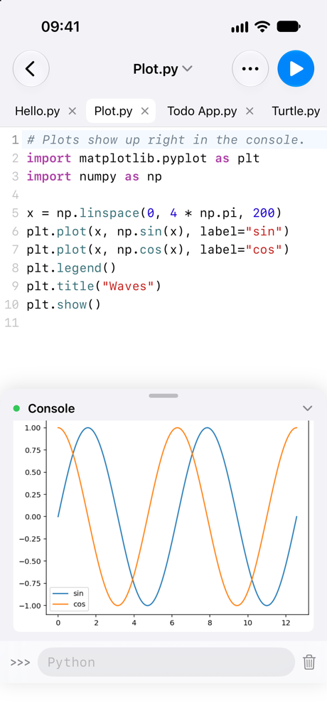
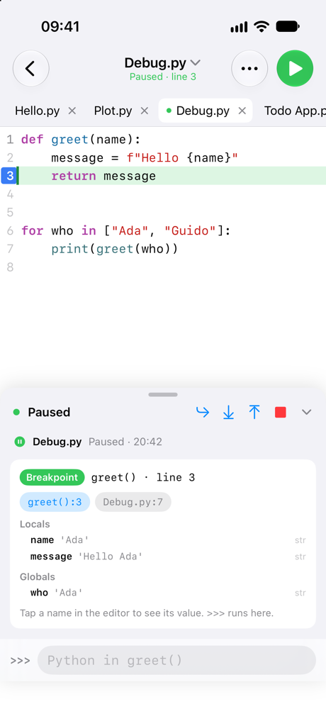
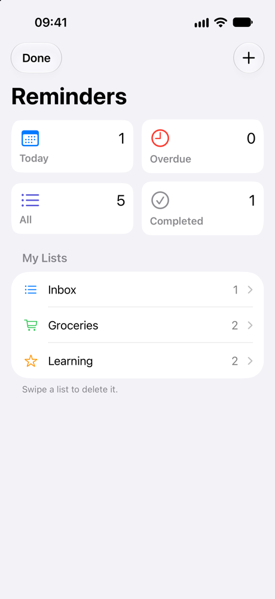
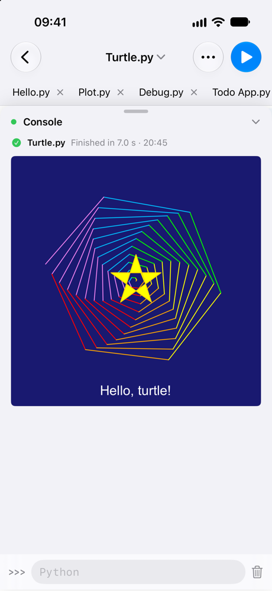
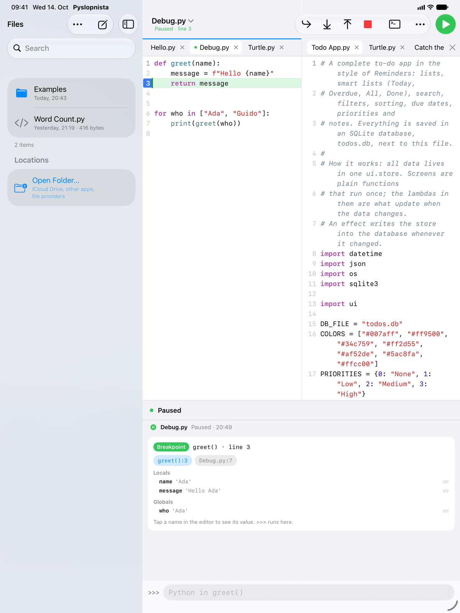
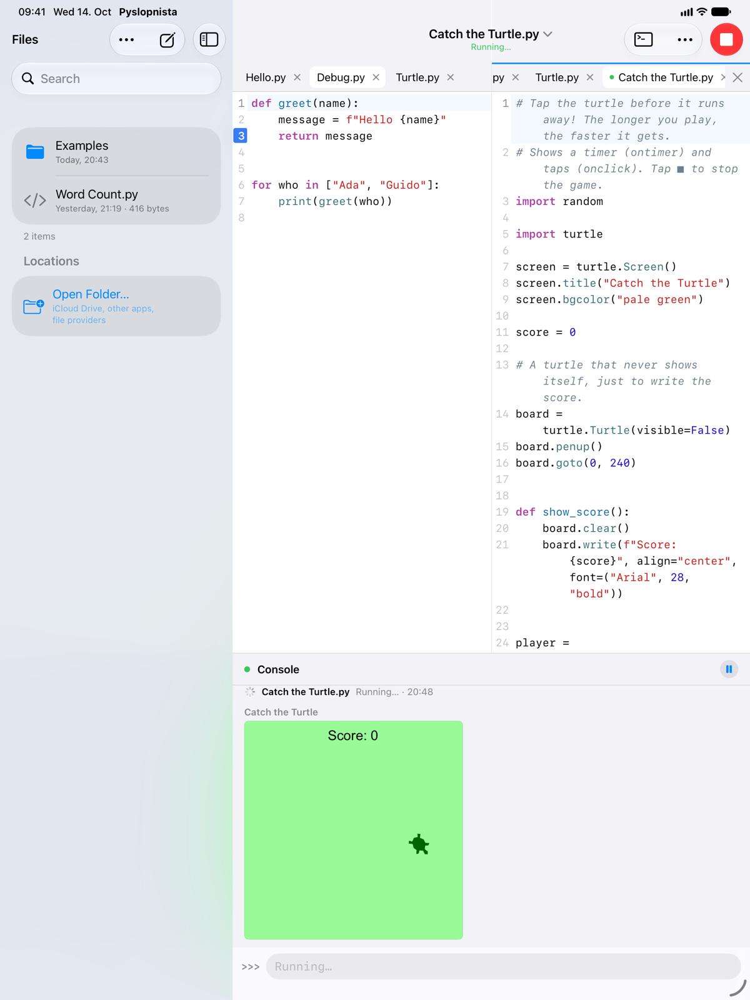

# Pyslopnista

A demo of a Pythonista-style Python IDE for iPhone and iPad: a native SwiftUI
app, with [Pyodide](https://pyodide.org/) running Python in a `WKWebView`
behind it.

> **This is a demo and research project.** It shows one way to run Pyodide
> (CPython compiled to WebAssembly) on iOS and build a usable IDE on top of it.
> I don't plan to ship it on the App Store. It is not affiliated with
> Pythonista or its author. Expect rough edges: it was written largely with
> coding agents (hence the "slop" in the name).

<p>
  
  
  
  
</p>
<p>
  
  
</p>

<sub>iPhone 17 and iPad Pro 13" simulators (iOS 27), the native SwiftUI app.</sub>

## What's in it

- **A Python IDE** (`app/`): files in the app's Documents folder (also visible
  in the Files app) and linked folders from iCloud Drive or other apps, a
  CodeMirror editor with a key bar for touch typing, a streaming console with
  `input()` and a `>>>` prompt, inline matplotlib, clickable tracebacks, tabs
  and iPad split view.
- **Code intelligence**: [ruff](https://github.com/astral-sh/ruff) (lint and
  format) and [ty](https://github.com/astral-sh/ty) (type checking,
  completions, go to definition) compiled to WebAssembly and running in a
  worker.
- **Packages**: Pyodide's compiled packages (numpy, pandas, matplotlib, ...)
  and pure-Python packages from PyPI, declared with PEP 723 script metadata
  (the same format `uv run` uses) and installed with micropip through a
  native on-disk cache.
- **A visual debugger**: breakpoints, stepping, variables and post-mortem
  inspection on top of `bdb`'s new `sys.monitoring` backend in Python 3.14.
- **A UI toolkit** (`uikit/`): a `ui` module with SolidJS-style signals that
  lets Python scripts build apps (navigation stacks, lists, sheets, inputs,
  canvas). In the app they are native SwiftUI views; published as web pages
  they are iOS-looking HTML. There is a complete Reminders-style todo app
  backed by SQLite in the examples.
- **HTTP without CORS limits**: `requests`, `httpx`, `urllib` and `pyfetch`
  are routed through the native host, which makes the real request with
  `URLSession`.
- **Spikes** (`spikes/`): the experiments that answered the hard questions
  first. Each has a README with the question, how to run it and the measured
  results.

```python
import ui

def Counter():
    count = ui.signal(0)
    return ui.Screen(
        "Counter",
        ui.Text(lambda: f"{count()} taps", font="largeTitle"),
        ui.Button("Tap me", on_click=lambda: count.update(lambda n: n + 1)),
    )

ui.run(Counter)
```

## Running it

You need Xcode 27 with an iOS 27 simulator, Node/npm,
[uv](https://docs.astral.sh/uv/), and Rust with `wasm-pack` (ty has no
published wasm package, so `app/scripts/build-ty.sh` builds it from a pinned
ruff commit).

```sh
cd app
./run.sh                 # build and launch in the booted simulator
./run.sh --selftest      # end-to-end checks in the simulator, prints JSON
./run.sh --device        # on a paired, unlocked iPhone

cd ../uikit
./run.sh                 # ui playground at http://127.0.0.1:18770/playground/
./run.sh --selftest      # host tests + headless Chrome checks
```

`run.sh` fetches the pinned Pyodide (314.0.7, i.e. Python 3.14) into
`app/vendor/` on first use. For device builds, change `DEVELOPMENT_TEAM` in
`app/ios/Pyslopnista.xcodeproj/project.pbxproj` to your own team.

## How it fits together

```
┌──────────────────────────── SwiftUI app ─────────────────────────────┐
│ files · tabs · console · debugger · find/go to · ui apps (native)    │
│ app:// scheme handler (COOP/COEP) · package + PyPI cache · HTTP      │
│  ┌──── engine web view (no UI) ────┐  ┌── editor web view(s) ──────┐ │
│  │ session, debugger protocol      │  │ CodeMirror, one per pane   │ │
│  │ ├── Python workers: Pyodide     │  │ lint/completions go to the │ │
│  │ └── analysis worker: ruff + ty  │◄─┤ engine through the host    │ │
│  └─────────────────────────────────┘  └────────────────────────────┘ │
└──────────────────────────────────────────────────────────────────────┘
```

- `app/`: the app. See [`app/README.md`](app/README.md) for features,
  layout, shortcuts and known gaps.
- `uikit/`: the `ui` module, renderer, examples and playground. See
  [`uikit/README.md`](uikit/README.md).
- `spikes/`: frozen experiments that serve as evidence for the decisions.
- [`GOALS.md`](GOALS.md): the intended feature set.
- [`DECISIONS.md`](DECISIONS.md): every design decision (D1-D31) with its
  reasoning and evidence, plus open questions.

## Tradeoffs, and why

The short version: **Python runs as WebAssembly inside WebKit because that is
the only place on iOS where code can be loaded at runtime, and everything else
follows from that.**

### Pyodide in WebKit instead of native CPython (D2, D3)

iOS doesn't let apps load native code at runtime. An embedded native CPython
can only use C extensions that were compiled and signed into the app bundle,
so `pip install numpy` on the device is impossible. Pyodide loads compiled
extensions as wasm modules at runtime, and WebKit is the only process on iOS
that is allowed to JIT. The WebContent process also isolates crashes and
memory from the app, and the same runtime runs in any browser, which makes
publishing scripts as web apps possible.

A hybrid (native interpreter, wasm extensions) was rejected: the CPython C
API assumes the interpreter and extensions share one address space, and
bridging that would need a proxy layer with a round trip per C API call.

What it costs:
- Speed: roughly 3-7x slower than native CPython on a Mac (iPhone 14 Pro),
  and about 1.1 s to boot an interpreter.
- No threads and no raw sockets (HTTP goes through the host instead).
- Memory: iOS kills the WebContent process at about 1.9 GB, without a
  `MemoryError`.
- Background: a running script is paused while the app is in the background.
- Python versions follow Pyodide releases, not CPython's.

### A native app with web views for Python and the editor (D30, D31)

The IDE started as a React app in a thin Swift host (D4, D18), which ran the
same in a desktop browser. Native polish (keyboard behavior, selection menus,
hardware shortcuts, lists, sheets) had to be fought for through WebKit, so
the IDE is now SwiftUI. Pyodide still needs WebKit: an engine web view
without UI runs the Python workers and ruff/ty, and the editor stays
CodeMirror in one web view per pane. The host talks to both through a bridge
with replies. `ui` apps are native SwiftUI views driven by the same op
stream the web renderer uses for published apps. The cost: no IDE in the
browser any more, three WebContent processes, and an IPC hop for every
editor and engine call.

### `app://` with cross-origin isolation and a `SharedArrayBuffer` polyfill (D9)

Interrupting Python and making blocking calls from Python need shared memory,
which needs a cross-origin-isolated page. A custom `app://` scheme handler
serves the web app with COOP/COEP headers. WKWebView still hides the global
`SharedArrayBuffer` constructor, but the one obtained from shared wasm memory
works, so the page and every worker install it as a polyfill.

### Workers, one interpreter per run (D6, D11, D16)

Each run gets a fresh interpreter in a Web Worker from a warm pool. Stop
raises `KeyboardInterrupt` and kills the worker if that doesn't work within
1.5 s, so a runaway script can't wedge the app.

The cost: WebKit gives worker threads a 512 KB native stack. Recursion
through C code (deeply nested `json.loads`, `repr`) can overflow it before
CPython's `RecursionError` kicks in, which kills the interpreter. The main
thread only gives 2-4x more on a device, which wasn't worth losing workers
for, so such a crash ends the run as "Python crashed" and the next run gets a
fresh worker.

### JSPI enabled, Atomics for our own blocking calls (D10, D13)

Pyodide's JSPI-based `run_sync` looked like it hung in WebKit. The cause was
CPython's Emscripten build sniffing the iOS user agent and falling back to a
JavaScript call trampoline (a workaround for a WebKit bug that has since been
fixed), which makes stack switching impossible. The worker hides the iOS user
agent before loading Pyodide, which brings back the wasm-GC trampoline and
working JSPI (verified on an iPhone 14 Pro). `input()`, `time.sleep` and
synchronous host calls still use a `SharedArrayBuffer` + `Atomics.wait`
channel, because it can be interrupted by Stop and doesn't depend on JSPI.
The details are in [`spikes/jspi-repro/`](spikes/jspi-repro/README.md).

### Files are copied into the interpreter and written back (D20, D27, D28)

A run copies its folder into Pyodide's in-memory file system, so `open()`,
`sqlite3` and sibling imports just work. Changed files are written back
whenever the program idles (within about a second) and when it ends, with
SQLite journals ordered so the database on disk stays consistent. This is
simple and robust, but the whole file is copied on every change: fine for app
data of a few MB, not for big databases. Linked folders from iCloud Drive or
other apps use security-scoped bookmarks and file coordination, and need no
entitlement.

### micropip and PEP 723, not uv inside the app (D12, D22)

uv cannot run in the browser sandbox without a large port, and its Pyodide
targets stop at 3.13. The app uses micropip against a PyPI proxy in the host
that caches downloads (offline after the first install), but keeps the
formats uv understands (PEP 723 script blocks, `pyproject.toml`), so the same
scripts run with `uv run` on a desktop. There are no lock files yet.

### ruff and ty as WebAssembly (D21)

Real lint, format, type checking and completions on the device, with no
server, at the price of about 30 MB of wasm. ty only knows the standard
library so far; imports of third-party packages are not type-checked.

### A debugger on `sys.monitoring` (D23)

Python 3.14's `bdb` monitoring backend makes breakpoints free until they are
hit (settrace-based pdb is 6-12x slower). That's why every run is debuggable
and there is no separate debug mode. The UI only appears once a program
stops.

### A Solid-style `ui` module (D14, D26)

The first version re-ran a `view()` function and diffed the whole tree on
every change, like React. Signals turned out to be both faster (one change
sends one op, instead of re-rendering 1,000 rows in about 25 ms) and easier
to explain ("the lambda is what updates"), and text fields keep focus and
caret without special care. The same fine-grained ops map directly onto one
observable SwiftUI node per element in the app (D30).

### HTTP through the host (D25)

Requests from the app's origin would hit CORS, so cross-origin `fetch` and
`XMLHttpRequest` calls from the worker are rerouted to the scheme handler,
which performs them natively. Python libraries need no app-specific code. It
is request/response only: no WebSockets, and responses are buffered rather
than streamed.

## Status

As of 2026-10-14: the native app's selftest passes in the iPhone 17 and iPad
Pro 13" simulators; an earlier set of checks of the web-based app passed on a
real iPhone 14 Pro. Many features have only
been tried in the simulator; `app/README.md` lists what has and hasn't been
tested on a device. A built-in coding agent based on pi-durable is planned
but not started (D8).

## Credits

This project is mostly glue. The hard parts were done by others:

- **[Pythonista](https://omz-software.com/pythonista/)** by Ole Zorn, the
  original and the inspiration. It showed years ago what Python on iOS
  should feel like.
- **[Pyodide](https://pyodide.org/)** and its contributors, for CPython in
  WebAssembly, the package repository, and micropip.
- **[CPython](https://www.python.org/)** and its WebAssembly/Emscripten
  support, including the `sys.monitoring` backend for `bdb` in 3.14.
- **[Emscripten](https://emscripten.org/)**, which Pyodide is built with.
- **[WebKit](https://webkit.org/)**, for JSPI, wasm GC and a JIT on iOS.
- **[CodeMirror](https://codemirror.net/)** by Marijn Haverbeke, the editor.
- **[Astral](https://astral.sh/)**, for
  [ruff](https://github.com/astral-sh/ruff) and
  [ty](https://github.com/astral-sh/ty) (and the ty playground, whose wasm
  build this follows), and for [uv](https://github.com/astral-sh/uv).
- **[SolidJS](https://www.solidjs.com/)** by Ryan Carniato, whose
  fine-grained reactivity model the `ui` module copies.
- **[pyodide-http](https://github.com/koenvo/pyodide-http)**, which patches
  `urllib` and `requests` to work in Pyodide.
- **[matplotlib](https://matplotlib.org/)**, **numpy**, **pandas** and the
  rest of the scientific Python stack, built for Pyodide.
- **[Vite](https://vite.dev/)** and
  **[TypeScript](https://www.typescriptlang.org/)** for the web pages,
  and [smol-toml](https://github.com/squirrelchat/smol-toml) for parsing
  `pyproject.toml`.
- **[jsDelivr](https://www.jsdelivr.com/)**, which serves Pyodide packages
  that aren't cached yet.
- **[pi](https://github.com/earendil-works/pi)**, created by Mario Zechner,
  the coding agent harness this was built with.
